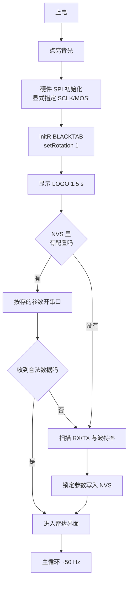

# 坎川工业 · 毫米波雷达跟踪器

ESP32-C3 + HLK-LD2450 24GHz 毫米波雷达 + ST7735 彩屏的实时目标跟踪与可视化固件。

屏幕上是半圆雷达图：横扫量程、目标光点、底部生命体征波形。开机先显示一块
**坎川工业** LOGO（齿轮 + 坎卦 ☵），然后直接进入雷达界面。

```
       ╭──────────────╮          量程 6 m / ±95°
      ╱   ●              ╲       最多同时 3 个目标
     │       ●            │      单条声呐波纹向外扩散
     │  ────────────      │      底部 ECG 心跳波形
      ╲                    ╱
       ╰──────────────────╯
        ▂▃▅▇▅▃▂▁▂▃▅▇▅▃▂
```

---

## 硬件

| 部件 | 型号 | 备注 |
|---|---|---|
| 主控 | **ESP32-C3 SuperMini** | QFN32 rev v0.4，4 MB XMC flash，原生 USB-Serial/JTAG |
| 雷达 | **HLK-LD2450** | 24 GHz FMCW，UART 输出，出厂 256000 baud |
| 屏幕 | **ST7735** 1.8" 160×128 | SPI，横屏（rotation 1） |
| 无线 | **433 MHz OOK** 发射/接收模组 | 主机接收接 GPIO20，从机发射接 P5.5 |
| 振动 | 振动开关（可选） | 有源低触发 |

> **无线频段已统一为 433 MHz**（原 315 方案不再使用）。
> 本协议是纯脉宽编码，解码只依赖 DATA 脚时序，与载波频率无关 ——
> 换频段不需要改任何解码代码，只需要按波长剪天线：
> **λ/4 ≈ 17.3 cm**（裸铜丝，直出）。315M 模组若临时换上，天线改 23.8 cm 即可。

### 接线

| ST7735 | ESP32-C3 | | HLK-LD2450 | ESP32-C3 |
|---|---|---|---|---|
| CS | GPIO1 | | TX | GPIO4 (RX) |
| DC | GPIO2 | | RX | GPIO5 (TX) |
| RST | GPIO3 | | VCC | **5V** |
| SCLK | **GPIO6** | | GND | GND |
| MOSI | **GPIO7** | | | |
| BLK | GPIO10 | | | |
| VCC | 3.3V | | | |
| GND | GND | | | |

**雷达要接 5V**，3.3V 供电会导致读数不稳甚至不出数。
振动开关接 GPIO8（可选）。

---

## 快速开始

### 1. 装依赖

```powershell
pip install -r requirements.txt          # 只需要 pyserial
pip install Pillow                        # 只有改 LOGO 才需要
```

### 2. 构建

```powershell
.\utils\build.ps1                 # 增量构建
.\utils\build.ps1 -Clean -Monitor # 干净重建 + 串口
```

### 3. 烧录

```powershell
.\utils\flash.ps1                 # 自动找串口 → 编译 → 烧录
.\utils\flash.ps1 -Monitor        # 烧完直接看串口
```

板子认不出来时：**按住 BOOT 再点一下 RESET**，让它进下载模式。

### 4. 改 LOGO

```powershell
python utils/fetch_seal_font.py                        # 想要篆书版先下字体
python utils/make_logo.py                              # 生成内置几何 LOGO
python utils/logo_converter.py utils\logo_160x128.png   # 转成固件点阵
.\utils\build.ps1
```

先看 `utils/logo_preview.png` 确认屏幕上的实际效果，再烧。

**换成自己的图**——把图片存成 `utils/logo.png`（也认 `.jpg/.jpeg/.bmp`）再跑
`logo_converter.py` 即可。自己放的图 `make_logo.py` 永远不会动。

---

## 工作原理

上电流程：



只识别一种数据帧头：`AA FF 03 00`，说明是雷达的目标跟踪帧。

雷达的**串口引脚和波特率只在第一次上电时扫描一次**，之后锁在 NVS 里，往后开机
直接按存的参数开串口，不再浪费时间扫描。想重新扫描：擦除 flash 重新上电。

主循环只做三件事：读帧 → 过滤 → 画。过滤条件是距离 0.05–8 m、角度 ±95°，
滤掉的是雷达偶发的 0 距离和越界噪声。

---

## 工程结构

```
HeartbeatSensor/
├── src/
│   ├── master/                     ★ 主机固件（ESP32-C3，PlatformIO）
│   │   ├── master.ino              主程序：初始化 + 主循环
│   │   ├── HLK_LD2450.h            雷达协议解析（header-only）
│   │   ├── RadarDisplay.h          雷达界面渲染（header-only）
│   │   ├── OokReceiver.h           433M OOK 接收 + 解帧
│   │   ├── ZoneManager.h           防区管理 / 配对 / NVS 持久化
│   │   ├── DebugLog.h              零堆分配日志 + 复位原因
│   │   ├── LogoImage.h             LOGO 点阵，脚本生成，勿手改
│   │   ├── TuyaLink.h              涂鸦云 MQTT + WiFi 状态机 + AP 配网
│   │   ├── TuyaConfig.h            涂鸦/配网参数集中配置
│   │   ├── QrTextImage.h           二维码说明文字点阵，脚本生成，勿手改
│   │   └── platformio.ini
│   └── slave/                      从机固件（STC8G1K08A，Keil C51）
├── docs/
│   ├── PROTOCOL-433M.md            OOK 无线协议说明
│   ├── TUYA-DP-SETUP.md            涂鸦 DP 建点与配网完整步骤
│   └── legacy-snapshots/           历史版本存档（不参与编译）
├── utils/
│   ├── build.ps1                   构建（主机）
│   ├── flash.ps1                   烧录（主机）
│   ├── build_slave.ps1             构建（从机，Keil UV4）
│   ├── make_logo.py                LOGO 生成器
│   ├── logo_converter.py           PNG → 固件点阵
│   ├── make_qr_text.py             二维码说明文字 → QrTextImage.h
│   ├── fetch_seal_font.py          下载小篆字体
│   ├── serial_monitor.py           串口监视（自动重连）
│   └── fonts/                      第三方字体（不入 Git）
├── CHANGELOG.md
├── LICENSE                          MIT
└── requirements.txt
```

**在维护的固件只有两个**：主机 `src/master/`（PlatformIO）、从机 `src/slave/`（Keil C51）。
`docs/legacy-snapshots/` 里的都是历史版本，别拿去编译。

从机固件构建（需要 Keil C51 V9.60+）：

```powershell
.\utils\build_slave.ps1          # 增量编译
.\utils\build_slave.ps1 -Clean   # 清理后完整重建
```

产出 `src\slave\Objects\slave.hex`，用 STC-ISP 烧录。

`slave.uvproj` **不能带 UTF-8 BOM**，否则 UV4 静默失败（`Exit=15`，
不写日志、不报错、无产物）。`build_slave.ps1` 已自动检测并剥离 BOM。

### PlatformIO 工程

`platformio.ini` 里用 `src_dir = .` 把 sketch 目录本身当源码根：

```powershell
pio run -d .\src\master              # 构建
pio run -d .\src\master -t upload    # 烧录
```

**不要同时跑两个 `pio run`**，会互相破坏 `.pio\build`。

---

## 显示实现要点

**SPI 初始化**：必须在 `display.initR()` 之前显式调用

```cpp
SPI.begin(TFT_SCLK, -1, TFT_MOSI, -1);
display.initR(INITR_BLACKTAB);
```

任何地方都不要再调无参 `SPI.begin()`。

**推帧规则**

- 整帧先合成到 `GFXcanvas16` 离屏缓冲，再一次性推上屏，不在屏上直接画
- 脏矩形起始列必须为偶数（`if (r0 & 1) r0--;`），否则非对齐访存 panic
- 每块脏矩形只做一次 `setAddrWindow`，连续 `writePixels` 推完
- 单帧脏像素预算默认 3000（`setPushBudget(3000)`），超预算的段留到下一帧继续推
- 背景静态部分开机预烘焙成 `_bg`，每帧一次 `memcpy`
- 推屏前确认 `!ookReceiver.inFrame() && ookReceiver.runSegs() == 0 && ookReceiver.pushSafe()`
- **分级强制放行**：120 ms 推不上去 → 软强制（预算 1200）；400 ms → 硬强制（预算 600）。
  没有这一层，WiFi 打开后 433 MHz 接收机自激会让安静窗永不成立，屏幕直接冻结。
  预算基线自适应（正常 +20/帧，硬强制 -300，下限 1500），形成负反馈，无需现场调参。

**SPI 时钟**：固定 20 MHz（`TFT_SPI_HZ = 20000000UL`）。40 MHz 会干扰 433 MHz 接收。

| SPI 时钟 | 整屏推送 |
|---|---|
| 40 MHz | 11.3 ms |
| 20 MHz | 19.4 ms |
| 16 MHz | 24.2 ms |
| 8 MHz | 48.5 ms |
## LOGO

### 设计

- **外圈**：齿轮，只有一层轮缘（没有内圈同心环），16 齿
- **中心**：坎卦 ☵ —— 上断、中实、下断
- **底部**：坎川工业

「坎」为水，「川」为河，两字本义皆水，所以抽象成卦象 + 几何，不用任何有机曲线。

配色：纯黑底 + **亮金 `#FFD800`** + **正红 `#E60012`**（中国红标准值）。
单色版本是为商标注册准备的——**申请时递黑白稿保护范围更宽**。

### 输出的版本

| 文件 | 尺寸 | 配色 | 用途 |
|---|---|---|---|
| `logo_abstract.png` | 800×800 | 亮金正红 | 彩色主图 |
| `logo_abstract_mono.png` | 800×800 | 黑底白图 | 印刷 |
| `logo_abstract_mono_inv.png` | 800×800 | 白底黑图 | 白纸 / 合同抬头 |
| `logo_abstract_icon.png` | 256×256 | 亮金正红 | 方形图标，无文字 |
| `logo_160x128.png` | 160×128 | 亮金正红 | **烧录用** |
| `logo_160x128_mono.png` | 160×128 | 黑白 | 屏幕尺寸单色版 |
| `*_seal.png` | 同上 | 同上 | 篆书字体版（需先下字体） |

## 常见问题

| 现象 | 处理 |
|---|---|
| 花屏 / 斜纹 / 撕裂 | 检查有无无参 `SPI.begin()`；脏矩形起始列是否为偶数 |
| 全白 / 全黑 | 量背光 GPIO10 是否为高；`initR` 参数是否正确 |
| 帧率低 | 确认 `TFT_SPI_HZ` 为 20 MHz；看每帧变化面积是否超预算 |
| 雷达不出数 | 供电须 5V；TX/RX 勿接反；串口看 `RAW:` 计数 |
| 开 WiFi 后屏幕卡住不动 | 看 `[HEALTH]` 后的 `[GATE]` 行：`fh` 一直涨说明 433 接收模块被 2.4 GHz 压得自激，属射频/摆位问题（挪远天线、加电源去耦）；`fh=0` 说明只是偶发延迟 |
| 目标颜色莫名变化 / 光点跳动 | 已由航迹跟踪消除；若仍出现，看是否为两个真实目标重叠 |
| 构建报 `intelhex` 找不到 | 改用系统 Python 下的 `pio`，脚本已自动优先选可用的 |
| 报 `.sconsign311.tmp` FileNotFoundError | 删掉 `.pio\build\esp32c3\.sconsign311*` 再构建 |
| 找不到串口 | 设备管理器 → 端口；`flash.ps1` 不带 `-Port` 会自动探测 |
| 烧录失败 | 按住 BOOT 点 RESET 进下载模式；或 `flash.ps1 -Raw` |
## 串口输出

115200 baud，**事件驱动**（不轮询、不刷屏）。正常静默运行，只有这些时候会有输出：

```
=== HEARTBEAT v7 C3 ===
[BOOT] reset=SW raw=0x03 heap=265004      ← 启动时：复位原因 + 空闲堆
[EEPROM] OK! Running                       ← 已从 NVS 恢复雷达参数
[OOK] RX on GPIO20
[BOOT] loop WDT enabled (5s)
[OK] RUNNING
[OOK] F7:94:C6:19:19:CB:3D flags=01 seq=51 ← 收到从机帧（只在首次见到设备时打）
[HEALTH] up=11m heap=180748 min=180748 loop=18ms ook=209 crc=2  ← 每 60 秒一行
[GATE] fs=0 fh=0                           ← 推屏门控强制放行次数
```

**[HEALTH] 是验证长期可靠性的唯一客观手段**，现场只需看三个数：

| 字段 | 含义 | 正常值 |
|---|---|---|
| `heap` | 当前空闲堆 | ≥ 180000，且**不单调下跌** |
| `min` | 上电以来最低水位 | **等于 heap ⇒ 零泄漏** |
| `loop` | 主循环最坏耗时 | 10–20 ms，必须远小于 5000（WDT） |
| `up` | 连续运行分钟数 | 递增；变小说明重启过 |
| `ook`/`crc` | 有效帧 / 校验错 | `crc` 应长期接近 0（1% 以内属信道正常噪声） |

**[GATE] 的判读**（联网后才需要看）：

| 数值 | 含义 |
|---|---|
| `fs=0 fh=0` | 门控从来没卡住过，正常 |
| `fs` 有小量、`fh=0` | 偶发安静窗不足，软强制就够，正常 |
| `fh` 持续增长 | 433 接收模块被 2.4 GHz 压得**持续自激**——屏幕靠硬强制保活，属射频/摆位问题，调固件无用 |

注：ESP32-C3 用原生 USB，**打开串口这一动作本身会让芯片复位**（DTR/RTS）。
想测真实连续运行时间，请用 `utils/serial_monitor.py`（已做 DTR/RTS 抑制 + 自动重连）。
**开机日志不含任何 `[E]` 行**。`platformio.ini` 里的
`-DCORE_DEBUG_LEVEL=0` 使 Arduino HAL 的 `log_e` / `log_w` / `log_i`
全部编译为空语句，所以像 `spiAttachMISO()` 这类
无害但看着像故障的提示不会出现。
若日志里真的冒出 `[E]`，那就是真故障，可以直接当报警看。

---

## 涂鸦云接入（可选功能）

默认关闭，离线优先。长按 BOOT 2 秒开 WiFi，再长按 2 秒关。

| 操作 | 效果 |
|---|---|
| 短按 BOOT | 切换屏幕页面 |
| 长按 2 s | 开 / 关 WiFi |
| 长按 5 s | 恢复出厂（清防区 + 清 WiFi + 清三元组） |

### 配网

1. 长按 BOOT 2 秒，设备开热点 `Kanchuan-HB-XXXX`（开放，无密码）
2. 手机连该热点，浏览器自动弹出配网页（或手动开 `192.168.4.1`）
3. 选路由、填密码，需要换设备时展开「涂鸦云三元组」填 DeviceID / DeviceSecret
4. 保存后设备自动重启并直连

三元组也可写死在 `TuyaConfig.h`（`TUYA_PRODUCT_ID` / `TUYA_DEVICE_ID` / `TUYA_DEVICE_SECRET`），NVS 优先于宏。

### DP

11 个，全部只上报（ro）。建点填表见 [`docs/TUYA-DP-SETUP.md`](docs/TUYA-DP-SETUP.md)。

| DP | 类型 | 说明 |
|---|---|---|
| `zone_a_presence` ~ `zone_d_presence` | bool | 各防区有人 |
| `zone_a_online` ~ `zone_d_online` | bool | 各防区从机在线 |
| `radar_distance` | 数值 | 最近目标距离，**cm** |
| `radar_angle` | 数值 | 最近目标角度，° |
| `radar_targets` | 数值 | 目标个数 0~3 |

数值型的「倍数」填 **`0`**（填 `1` 会被平台当成一位小数，APP 上数字小 10 倍）。

### 绑定 App

设备在开发者平台「设备调试」页可直接看数据。涂鸦智能 App **扫码添加不适用**——本固件直连云 MQTT，不走 App 配网，不产生绑定 token。要进 App 需走云开发 OpenAPI 绑定或自研 App。

---


## 雷达规格

| 项目 | 参数 |
|---|---|
| 探测距离 | 0–6 m（本工程） |
| 角度范围 | ±60°（本工程过滤到 ±95°） |
| 最大目标 | 3 个 |
| 协议 | UART，头部 `AA FF 03 00` |
| 刷新率 | ~10 Hz（模组侧） |
| 屏幕量程标注 | 圈上标 `2m` / `4m` / `6m` |

### 航迹跟踪（为什么显示是稳的）

传感器本身只有 3 个目标槽位，而且会随时重排。直接照抄它的输出会看到三种
「不准」，本工程在画之前加了一层航迹跟踪来消除：

| 现象 | 原因 | 处理 |
|---|---|---|
| 同一个人莫名其妙换颜色 | 颜色按传感器槽位取，槽位会重排 | 持久航迹池 + 最近邻关联，目标自己占住一个槽 |
| 光点持续小幅抖动 | 传感器 10 Hz、屏幕 50 Hz，同一采样重复画 5 帧 | EMA 平滑（系数 0.45） |
| 目标偶尔闪一下消失 | 传感器漏采一次（该槽 x=y=0） | 350 ms 短时保持 |
| 角度偏一点 | 原按 2° 栅格对齐后查表 | 2° 查表 + 线性插值，量化误差 ~0.02° |

精确数值以云端 DP 为准（`radar_distance` 1 cm / `radar_angle` 1°），
屏幕上只标量程圈 `2m` / `4m` / `6m` 和方位角刻度 `-60 / -30 / 30 / 60`，
不占额外版面。

---

## 许可

MIT，见 [LICENSE](LICENSE)。

## 致谢

- **Adafruit** — GFX / ST7735 驱动
- **Hi-Link 海凌科** — HLK-LD2450 及协议文档
- **中央研究院 數位文化中心** — 崇羲篆體（小篆字体）
