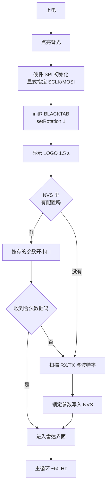

# 坎川工业 · 毫米波雷达跟踪器

ESP32-C3 + HLK-LD2450 24GHz 毫米波雷达 + ST7735 彩屏的实时目标跟踪与可视化固件。

屏幕上是半圆雷达图：横扫量程、目标光点、底部生命体征波形。开机先显示一块
**坎川工业** LOGO（齿轮 + 坎卦 ☵），然后直接进入雷达界面。

```
       ╭──────────────╮          量程 6 m / ±95°
      ╱   ●              ╲       最多同时 3 个目标
     │       ●            │      单条声呐波纹向外扩散
     │  ────────────      │      底部 ECG 心跳波形
      ╲                    ╱
       ╰──────────────────╯
        ▂▃▅▇▅▃▂▁▂▃▅▇▅▃▂
```

---

## 硬件

| 部件 | 型号 | 备注 |
|---|---|---|
| 主控 | **ESP32-C3 SuperMini** | QFN32 rev v0.4，4 MB XMC flash，原生 USB-Serial/JTAG |
| 雷达 | **HLK-LD2450** | 24 GHz FMCW，UART 输出，出厂 256000 baud |
| 屏幕 | **ST7735** 1.8" 160×128 | SPI，横屏（rotation 1） |
| 振动 | 振动开关（可选） | 有源低触发 |

### 接线

| ST7735 | ESP32-C3 | | HLK-LD2450 | ESP32-C3 |
|---|---|---|---|---|
| CS | GPIO1 | | TX | GPIO4 (RX) |
| DC | GPIO2 | | RX | GPIO5 (TX) |
| RST | GPIO3 | | VCC | **5V** |
| SCLK | **GPIO6** | | GND | GND |
| MOSI | **GPIO7** | | | |
| BLK | GPIO10 | | | |
| VCC | 3.3V | | | |
| GND | GND | | | |

> ⚠️ **雷达要接 5V**，3.3V 供电会导致读数不稳甚至不出数。
> 振动开关接 GPIO8（可选）。

---

## 快速开始

### 1. 装依赖

```powershell
pip install -r requirements.txt          # 只需要 pyserial
pip install Pillow                        # 只有改 LOGO 才需要
```

### 2. 构建

```powershell
.\utils\build.ps1                 # 增量构建
.\utils\build.ps1 -Clean -Monitor # 干净重建 + 串口
```

### 3. 烧录

```powershell
.\utils\flash.ps1                 # 自动找串口 → 编译 → 烧录
.\utils\flash.ps1 -Monitor        # 烧完直接看串口
```

板子认不出来时：**按住 BOOT 再点一下 RESET**，让它进下载模式。

### 4. 改 LOGO

```powershell
python utils/fetch_seal_font.py                        # 想要篆书版先下字体
python utils/make_logo.py                              # 生成内置几何 LOGO
python utils/logo_converter.py utils\logo_160x128.png   # 转成固件点阵
.\utils\build.ps1
```

先看 `utils/logo_preview.png` 确认屏幕上的实际效果，再烧。

**换成自己的图**——把图片存成 `utils/logo.png`（也认 `.jpg/.jpeg/.bmp`）再跑
`logo_converter.py` 即可。自己放的图 `make_logo.py` 永远不会动。

---

## 工作原理

上电流程：



只识别一种数据帧头：`AA FF 03 00`，说明是雷达的目标跟踪帧。

雷达的**串口引脚和波特率只在第一次上电时扫描一次**，之后锁在 NVS 里，往后开机
直接按存的参数开串口，不再浪费时间扫描。想重新扫描：擦除 flash 重新上电。

主循环只做三件事：读帧 → 过滤 → 画。过滤条件是距离 0.05–8 m、角度 ±95°，
滤掉的是雷达偶发的 0 距离和越界噪声。

---

## 工程结构

```
esp32-radar-tracker-main/
├── arduino/
│   └── ESP32_C3_Radar_Tracker/     ★ 唯一在维护的固件
│       ├── ESP32_C3_Radar_Tracker.ino   主程序：初始化 + 主循环
│       ├── HLK_LD2450.h                 雷达协议解析（header-only）
│       ├── RadarDisplay.h               雷达界面渲染（header-only）
│       ├── LogoImage.h                  LOGO 点阵，脚本生成，勿手改
│       └── platformio.ini
├── diag/
│   └── spi_speed_test/             SPI 频率扫描诊断，独立工程
├── docs/
│   └── legacy-snapshots/           历史版本存档（不参与编译）
├── utils/
│   ├── build.ps1                   构建
│   ├── flash.ps1                   烧录
│   ├── make_logo.py                LOGO 生成器
│   ├── logo_converter.py           PNG → 固件点阵
│   ├── fetch_seal_font.py          下载小篆字体
│   ├── serial_monitor.py           串口监视（简易）
│   └── fonts/                      第三方字体（不入 Git）
├── .gitattributes / .gitignore
├── LICENSE                          MIT
└── requirements.txt
```

**只有一个固件工程在维护**，就是 `arduino/ESP32_C3_Radar_Tracker/`。
其它在 `docs/legacy-snapshots/` 里的都是历史版本，别拿去编译。

### 分开的 PlatformIO 工程

每个工程自带 `platformio.ini`，靠 `src_dir = .` 把 sketch 目录本身当源码根：

```powershell
pio run -d "arduino\ESP32_C3_Radar_Tracker"     # 主固件
pio run -d "diag\spi_speed_test"                # 诊断
```

---

## ⚠️ 三个必须知道的坑

这三个都是实际调试中花了很多时间才定位到的，改代码前请务必读一遍。

### 坑 1：SPI 必须在 `initR()` 之前显式 `begin()`

```cpp
// ✅ 必须这样
SPI.begin(TFT_SCLK, -1, TFT_MOSI, -1);
display.initR(INITR_BLACKTAB);
```

GPIO6/7 是 C3 的专用 SPI2 IO_MUX 引脚，但 Arduino 的 C3 变体文件里
`pins_arduino.h` 还留着旧的 `SCK=4 / MISO=5 / MOSI=6 / SS=7`。只要哪里调了一次
**无参** `SPI.begin()`，SCLK 就会被重映射到 GPIO4 → **必然花屏**。

### 坑 2：整帧只能单窗口一次推完

```cpp
// ✅ RadarDisplay.h::pushCanvas()，唯一允许的推送路径
_d->startWrite();
_d->setAddrWindow(0, 0, SCREEN_W, SCREEN_H);
_d->writePixels(_cv.getBuffer(), (uint32_t)SCREEN_W * SCREEN_H);
_d->endWrite();
```

历史上一堆花屏 / 斜纹 / 撕裂，根因全都是分了多次 `setAddrWindow` 或用了小块
`pushPixels`。**不要走别的路径**，也不要从 `docs/legacy-snapshots/` 抄渲染代码。

### 坑 3：没有 SPI DMA，帧率靠时钟堆

ESP32 的 Arduino core 没有曝露 SPI DMA。整帧 40 KB（160×128×2）实测：

| SPI 时钟 | 单帧耗时 | 帧率 |
|---|---|---|
| 20 MHz | 19.4 ms | **≈ 44 fps** |
| 16 MHz | 24.2 ms | ≈ 41 fps |
| 8 MHz | 48.5 ms | ≈ 20 fps |

现在是 **20 MHz**。杜邦线长 / 干扰大导致闪屏时，改 `TFT_SPI_HZ` 逐档往下降到
16 / 12 / 8 MHz。要精确定位，用 `diag/spi_speed_test/` 那个独立工程。

---

## LOGO

### 设计

- **外圈**：齿轮，只有一层轮缘（没有内圈同心环），16 齿
- **中心**：坎卦 ☵ —— 上断、中实、下断
- **底部**：坎川工业

「坎」为水，「川」为河，两字本义皆水，所以抽象成卦象 + 几何，不用任何有机曲线。

配色：纯黑底 + **亮金 `#FFD800`** + **正红 `#E60012`**（中国红标准值）。
单色版本是为商标注册准备的——**申请时递黑白稿保护范围更宽**。

### 输出的版本

| 文件 | 尺寸 | 配色 | 用途 |
|---|---|---|---|
| `logo_abstract.png` | 800×800 | 亮金正红 | 彩色主图 |
| `logo_abstract_mono.png` | 800×800 | 黑底白图 | 印刷 |
| `logo_abstract_mono_inv.png` | 800×800 | 白底黑图 | 白纸 / 合同抬头 |
| `logo_abstract_icon.png` | 256×256 | 亮金正红 | 方形图标，无文字 |
| `logo_160x128.png` | 160×128 | 亮金正红 | **烧录用** |
| `logo_160x128_mono.png` | 160×128 | 黑白 | 屏幕尺寸单色版 |
| `*_seal.png` | 同上 | 同上 | 篆书字体版（需先下字体） |

### 小篆字体的实测结论

装了篆书能生成篆书版 LOGO，但**小屏上别用**：

| 字号 | 20 px | 26 px |
|---|---|---|
| 崇羲篆體 | 糊成一团，认不出 | 勉强可辨 |
| 黑体 | 清晰 | 清晰 |

篆书笔画细密，160×128 的屏上根本展不开。**结论：篆书只用于大幅面 / 印刷版，
设备开机画面继续用黑体。**

另外崇羲篆體**缺「业」字**，直接渲染会出方块。`make_logo.py` 里的
`fallback_font_for_text()` 会在文本含「业」时自动整串换回黑体。判断字体缺字不能
只看 `textbbox()`——它对缺字也会返回一个像样的方框，得看实际像素。

字体 21.8 MB，不入 Git，克隆后跑 `python utils/fetch_seal_font.py` 取回。

---

## 常见问题

**屏幕花屏 / 斜纹 / 撕裂**
检查有没有别的地方调了无参 `SPI.begin()`，以及有没有绕过 `pushCanvas()`。

**屏幕全白或全黑**
先量背光 GPIO10 是否为高。全白通常是 `initR` 参数不对或 SPI 没起来。

**帧率低、画面卡**
先确认 `TFT_SPI_HZ` 是 20 MHz。若已是，用 `diag/spi_speed_test/` 扫一遍找上限。

**雷达不出数**
① 供电必须 5V；② TX/RX 是否接反；③ 串口看 `RAW:` 计数，一直是 0 说明没数据
进来；④ 擦除 flash 后重新上电让它重新扫描。

**构建报 `intelhex` 找不到**
`C:\.platformio\penv\Scripts\pio.exe` 缺 `intelhex`，换用系统 Python 下那个
`pio`。`build.ps1` / `flash.ps1` 已自动优先选可用的那个。

**报 `.sconsign311.tmp` FileNotFoundError**
删掉 `arduino\ESP32_C3_Radar_Tracker\.pio\build\esp32c3\.sconsign311*` 再构建。

**找不到串口**
Windows 上是 CDC 网卡驱动，检查设备管理器 → 端口。`flash.ps1` 不带 `-Port`
时会自动探测，多个会让你选。

**烧录失败**
按住 BOOT 再点 RESET 进下载模式。还不行就用 `.\utils\flash.ps1 -Raw` 走
esptool 手动烧录。

---

## 串口输出

115200 baud。每秒一行：

```
T:2 F:44 RAW:1204 BAUD:256000
│  │  │    └─ 锁定的波特率
│  │  └────── 收到过的原始字节数（一直是 0 = 雷达没数据）
│  └───────── 帧率 fps
└──────────── 当前目标数
```

---

## 雷达规格

| 项目 | 参数 |
|---|---|
| 探测距离 | 0–6 m（本工程） |
| 角度范围 | ±60°（本工程过滤到 ±95°） |
| 最大目标 | 3 个 |
| 协议 | UART，头部 `AA FF 03 00` |
| 刷新率 | ~10 Hz（模组侧） |

---

## 许可

MIT，见 [LICENSE](LICENSE)。

## 致谢

- **Adafruit** — GFX / ST7735 驱动
- **Hi-Link 海凌科** — HLK-LD2450 及协议文档
- **中央研究院 數位文化中心** — 崇羲篆體（小篆字体）
