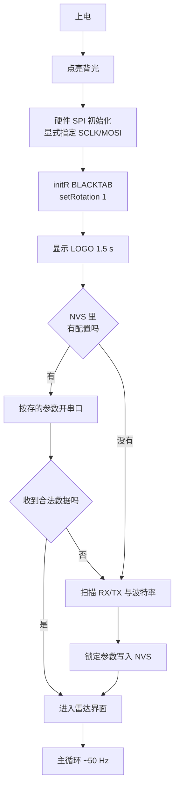

# 坎川工业 · 毫米波雷达跟踪器

ESP32-C3 + HLK-LD2450 24GHz 毫米波雷达 + ST7735 彩屏的实时目标跟踪与可视化固件。

屏幕上是半圆雷达图：横扫量程、目标光点、底部生命体征波形。开机先显示一块
**坎川工业** LOGO（齿轮 + 坎卦 ☵），然后直接进入雷达界面。

```
       ╭──────────────╮          量程 6 m / ±95°
      ╱   ●              ╲       最多同时 3 个目标
     │       ●            │      单条声呐波纹向外扩散
     │  ────────────      │      底部 ECG 心跳波形
      ╲                    ╱
       ╰──────────────────╯
        ▂▃▅▇▅▃▂▁▂▃▅▇▅▃▂
```

---

## 硬件

| 部件 | 型号 | 备注 |
|---|---|---|
| 主控 | **ESP32-C3 SuperMini** | QFN32 rev v0.4，4 MB XMC flash，原生 USB-Serial/JTAG |
| 雷达 | **HLK-LD2450** | 24 GHz FMCW，UART 输出，出厂 256000 baud |
| 屏幕 | **ST7735** 1.8" 160×128 | SPI，横屏（rotation 1） |
| 振动 | 振动开关（可选） | 有源低触发 |

### 接线

| ST7735 | ESP32-C3 | | HLK-LD2450 | ESP32-C3 |
|---|---|---|---|---|
| CS | GPIO1 | | TX | GPIO4 (RX) |
| DC | GPIO2 | | RX | GPIO5 (TX) |
| RST | GPIO3 | | VCC | **5V** |
| SCLK | **GPIO6** | | GND | GND |
| MOSI | **GPIO7** | | | |
| BLK | GPIO10 | | | |
| VCC | 3.3V | | | |
| GND | GND | | | |

> ⚠️ **雷达要接 5V**，3.3V 供电会导致读数不稳甚至不出数。
> 振动开关接 GPIO8（可选）。

---

## 快速开始

### 1. 装依赖

```powershell
pip install -r requirements.txt          # 只需要 pyserial
pip install Pillow                        # 只有改 LOGO 才需要
```

### 2. 构建

```powershell
.\utils\build.ps1                 # 增量构建
.\utils\build.ps1 -Clean -Monitor # 干净重建 + 串口
```

### 3. 烧录

```powershell
.\utils\flash.ps1                 # 自动找串口 → 编译 → 烧录
.\utils\flash.ps1 -Monitor        # 烧完直接看串口
```

板子认不出来时：**按住 BOOT 再点一下 RESET**，让它进下载模式。

### 4. 改 LOGO

```powershell
python utils/fetch_seal_font.py                        # 想要篆书版先下字体
python utils/make_logo.py                              # 生成内置几何 LOGO
python utils/logo_converter.py utils\logo_160x128.png   # 转成固件点阵
.\utils\build.ps1
```

先看 `utils/logo_preview.png` 确认屏幕上的实际效果，再烧。

**换成自己的图**——把图片存成 `utils/logo.png`（也认 `.jpg/.jpeg/.bmp`）再跑
`logo_converter.py` 即可。自己放的图 `make_logo.py` 永远不会动。

---

## 工作原理

上电流程：



只识别一种数据帧头：`AA FF 03 00`，说明是雷达的目标跟踪帧。

雷达的**串口引脚和波特率只在第一次上电时扫描一次**，之后锁在 NVS 里，往后开机
直接按存的参数开串口，不再浪费时间扫描。想重新扫描：擦除 flash 重新上电。

主循环只做三件事：读帧 → 过滤 → 画。过滤条件是距离 0.05–8 m、角度 ±95°，
滤掉的是雷达偶发的 0 距离和越界噪声。

---

## 工程结构

```
HeartbeatSensor/
├── src/
│   ├── master/                     ★ 主机固件（ESP32-C3，PlatformIO）
│   │   ├── master.ino              主程序：初始化 + 主循环
│   │   ├── HLK_LD2450.h            雷达协议解析（header-only）
│   │   ├── RadarDisplay.h          雷达界面渲染（header-only）
│   │   ├── OokReceiver.h           315/433M OOK 接收 + 解帧
│   │   ├── ZoneManager.h           防区管理 / 配对 / NVS 持久化
│   │   ├── DebugLog.h              零堆分配日志 + 复位原因
│   │   ├── LogoImage.h             LOGO 点阵，脚本生成，勿手改
│   │   ├── TuyaLink.h              涂鸦云 MQTT + WiFi 状态机 + AP 配网
│   │   ├── TuyaConfig.h            涂鸦/配网参数集中配置
│   │   ├── QrTextImage.h           二维码说明文字点阵，脚本生成，勿手改
│   │   └── platformio.ini
│   └── slave/                      从机固件（STC8G1K08A，Keil C51）
├── docs/
│   ├── PROTOCOL-315M.md            OOK 无线协议说明
│   ├── TUYA-DP-SETUP.md            涂鸦 DP 建点与配网完整步骤
│   └── legacy-snapshots/           历史版本存档（不参与编译）
├── utils/
│   ├── build.ps1                   构建（主机）
│   ├── flash.ps1                   烧录（主机）
│   ├── build_slave.ps1             构建（从机，Keil UV4）
│   ├── make_logo.py                LOGO 生成器
│   ├── logo_converter.py           PNG → 固件点阵
│   ├── make_qr_text.py             二维码说明文字 → QrTextImage.h
│   ├── fetch_seal_font.py          下载小篆字体
│   ├── serial_monitor.py           串口监视（自动重连）
│   └── fonts/                      第三方字体（不入 Git）
├── CHANGELOG.md
├── LICENSE                          MIT
└── requirements.txt
```

**在维护的固件只有两个**：主机 `src/master/`（PlatformIO）、从机 `src/slave/`（Keil C51）。
`docs/legacy-snapshots/` 里的都是历史版本，别拿去编译。

从机固件构建（需要 Keil C51 V9.60+）：

```powershell
.\utils\build_slave.ps1          # 增量编译
.\utils\build_slave.ps1 -Clean   # 清理后完整重建
```

产出 `src\slave\Objects\slave.hex`，用 STC-ISP 烧录。

> ⚠️ `slave.uvproj` **不能带 UTF-8 BOM**，否则 UV4 静默失败（`Exit=15`，
> 不写日志、不报错、无产物）。`build_slave.ps1` 已自动检测并剥离 BOM。

### PlatformIO 工程

`platformio.ini` 里用 `src_dir = .` 把 sketch 目录本身当源码根：

```powershell
pio run -d .\src\master              # 构建
pio run -d .\src\master -t upload    # 烧录
```

> ⚠️ **不要同时跑两个 `pio run`**，会互相破坏 `.pio\build`。

---

## ⚠️ 三个必须知道的坑

这三个都是实际调试中花了很多时间才定位到的，改代码前请务必读一遍。

### 坑 1：SPI 必须在 `initR()` 之前显式 `begin()`

```cpp
// ✅ 必须这样
SPI.begin(TFT_SCLK, -1, TFT_MOSI, -1);
display.initR(INITR_BLACKTAB);
```

GPIO6/7 是 C3 的专用 SPI2 IO_MUX 引脚，但 Arduino 的 C3 变体文件里
`pins_arduino.h` 还留着旧的 `SCK=4 / MISO=5 / MOSI=6 / SS=7`。只要哪里调了一次
**无参** `SPI.begin()`，SCLK 就会被重映射到 GPIO4 → **必然花屏**。

### 坑 2：推帧必须遵守两条硬规则

渲染分两层，各有一条不能破的规则。

**① 所有绘制先在 RAM 画布里完成**

```cpp
// RadarDisplay 内部：全屏离屏缓冲
GFXcanvas16 _cv;                 // 160×128×2 = 40 KB
```

整帧先合成到 `_cv`，再一次性推上屏。**绝不在屏幕上直接画。**

**② 推像素的起始列必须是偶数**

```cpp
if (r0 & 1) { r0--; }            // ← 不能删
```

Adafruit 的 `writePixels()` 在 ESP32 平台走 `spiWritePixelsNL()`，内部是：

```c
uint32_t *data = (uint32_t*)data_in;    // 硬转换，没有任何对齐检查
```

RISC-V 不做非对齐访存（会直接 `LoadStoreAlignment` panic）。偏移是
`y*160 + x` 个像素、乘 2 得字节；160 的倍数恒为偶数，所以**只要 x 是偶数，
地址就一定 4 字节对齐**。脏矩形如果从奇数列开始，就会崩。

**③ 花屏的历史教训**

早期一堆花屏 / 斜纹 / 撕裂，根因全都是把整屏拆成多次 `setAddrWindow` +
小块 `pushPixels`。现在的脏矩形方案仍然遵守「一个窗口一次推完」：
每块脏矩形只做一次 `setAddrWindow`，然后连续 `writePixels`。
**不要从 `docs/legacy-snapshots/` 抄渲染代码。**

### 坑 3：帧率靠「少推」而不是「推得快」

ESP32 的 Arduino core 没有暴露 SPI DMA，40 KB 整屏推一次是硬开销：

| SPI 时钟 | 整屏推送 |
|---|---|
| 40 MHz | 11.3 ms |
| 20 MHz | 19.4 ms |
| 16 MHz | 24.2 ms |
| 8 MHz | 48.5 ms |

**现在固定 20 MHz（`TFT_SPI_HZ = 20000000UL`），不要往上提。**
40 MHz 时 SPI 的边沿瞬变会耦合到 315 MHz 接收模块的 DATA 脚上，
把电平打成毛刺、比特翻错（实测 `crc > 0`）；20 MHz 实测 `crc = 0`。
推屏慢一倍的代价并不存在 —— 因为单次推屏已被预算限到 3000 脏像素（约 2.4 ms）。

真正解决卡顿的不是时钟，而是两件事叠加：

1. **脏矩形只推变化的 1–4 KB**——典型一帧从 19.4 ms 降到 1–3 ms。
   背景（圆环 / 刻度 / 量程标签）是静态的，开机时预烘焙成 `_bg`，
   每帧一次 40 KB `memcpy`（约 60 µs）即可，不再重画。
2. **单帧脏像素预算 3000px**（`setPushBudget(3000)`）。超预算时本帧不推、
   且**不更新 `_prev`**，差异累积到下一帧 —— 内容不丢，只是延后几十毫秒。
   有限预算模式下**禁止整屏推送**（那 19–21 ms 连续 SPI 会稳定致盲接收机）。

推屏还必须避开 315 MHz 收帧窗口：
`!ookReceiver.inFrame() && ookReceiver.runSegs() == 0 && ookReceiver.pushSafe()`
（`OOK_GAP_SAFE_US = 10000`，详见 `OokReceiver.h` 里的说明）。

> ⚠️ **不要重新引入 `OokReceiver::onPushDone()`**。它会在推屏后清空 RMT
> 环形缓冲，丢掉硬件刚录下的真边沿，并让 `pushSafe()` 永久放行形成死循环。

杜邦线长 / 干扰大导致闪屏时，把 `TFT_SPI_HZ` 逐档往下降。

---

## LOGO

### 设计

- **外圈**：齿轮，只有一层轮缘（没有内圈同心环），16 齿
- **中心**：坎卦 ☵ —— 上断、中实、下断
- **底部**：坎川工业

「坎」为水，「川」为河，两字本义皆水，所以抽象成卦象 + 几何，不用任何有机曲线。

配色：纯黑底 + **亮金 `#FFD800`** + **正红 `#E60012`**（中国红标准值）。
单色版本是为商标注册准备的——**申请时递黑白稿保护范围更宽**。

### 输出的版本

| 文件 | 尺寸 | 配色 | 用途 |
|---|---|---|---|
| `logo_abstract.png` | 800×800 | 亮金正红 | 彩色主图 |
| `logo_abstract_mono.png` | 800×800 | 黑底白图 | 印刷 |
| `logo_abstract_mono_inv.png` | 800×800 | 白底黑图 | 白纸 / 合同抬头 |
| `logo_abstract_icon.png` | 256×256 | 亮金正红 | 方形图标，无文字 |
| `logo_160x128.png` | 160×128 | 亮金正红 | **烧录用** |
| `logo_160x128_mono.png` | 160×128 | 黑白 | 屏幕尺寸单色版 |
| `*_seal.png` | 同上 | 同上 | 篆书字体版（需先下字体） |

### 小篆字体的实测结论

装了篆书能生成篆书版 LOGO，但**小屏上别用**：

| 字号 | 20 px | 26 px |
|---|---|---|
| 崇羲篆體 | 糊成一团，认不出 | 勉强可辨 |
| 黑体 | 清晰 | 清晰 |

篆书笔画细密，160×128 的屏上根本展不开。**结论：篆书只用于大幅面 / 印刷版，
设备开机画面继续用黑体。**

另外崇羲篆體**缺「业」字**，直接渲染会出方块。`make_logo.py` 里的
`fallback_font_for_text()` 会在文本含「业」时自动整串换回黑体。判断字体缺字不能
只看 `textbbox()`——它对缺字也会返回一个像样的方框，得看实际像素。

字体 21.8 MB，不入 Git，克隆后跑 `python utils/fetch_seal_font.py` 取回。

---

## 常见问题

**屏幕花屏 / 斜纹 / 撕裂**
检查有没有别的地方调了无参 `SPI.begin()`；以及脏矩形推送时起始列是否保证为偶数
（见「坑 2」）。

**屏幕全白或全黑**
先量背光 GPIO10 是否为高。全白通常是 `initR` 参数不对或 SPI 没起来。

**帧率低、画面卡**
先看 `TFT_SPI_HZ` 是否被调低了（应为 20 MHz，**不是** 40 MHz）。真正的帧率靠
脏矩形 + 3000px 预算——若卡，先确认 `[BOOT]` 日志里没有反复复位，
以及每帧变化的面积是否异常大（超预算会跳帧，帧率看起来会掉）。

**雷达不出数**
① 供电必须 5V；② TX/RX 是否接反；③ 串口看 `RAW:` 计数，一直是 0 说明没数据
进来；④ 擦除 flash 后重新上电让它重新扫描。

**构建报 `intelhex` 找不到**
`C:\.platformio\penv\Scripts\pio.exe` 缺 `intelhex`，换用系统 Python 下那个
`pio`。`build.ps1` / `flash.ps1` 已自动优先选可用的那个。

**报 `.sconsign311.tmp` FileNotFoundError**
删掉 `arduino\ESP32_C3_Radar_Tracker\.pio\build\esp32c3\.sconsign311*` 再构建。

**找不到串口**
Windows 上是 CDC 网卡驱动，检查设备管理器 → 端口。`flash.ps1` 不带 `-Port`
时会自动探测，多个会让你选。

**烧录失败**
按住 BOOT 再点 RESET 进下载模式。还不行就用 `.\utils\flash.ps1 -Raw` 走
esptool 手动烧录。

---

## 串口输出

115200 baud，**事件驱动**（不轮询、不刷屏）。正常静默运行，只有这些时候会有输出：

```
=== HEARTBEAT v7 C3 ===
[BOOT] reset=SW raw=0x03 heap=265004      ← 启动时：复位原因 + 空闲堆
[EEPROM] OK! Running                       ← 已从 NVS 恢复雷达参数
[OOK] RX on GPIO20
[BOOT] loop WDT enabled (5s)
[OK] RUNNING
[OOK] F7:94:C6:19:19:CB:3D flags=01 seq=51 ← 收到从机帧（只在首次见到设备时打）
[HEALTH] up=11m heap=180748 min=180748 loop=18ms ook=209 crc=2  ← 每 60 秒一行
```

**[HEALTH] 是验证长期可靠性的唯一客观手段**，现场只需看三个数：

| 字段 | 含义 | 正常值 |
|---|---|---|
| `heap` | 当前空闲堆 | ≥ 180000，且**不单调下跌** |
| `min` | 上电以来最低水位 | **等于 heap ⇒ 零泄漏** |
| `loop` | 主循环最坏耗时 | 10–20 ms，必须远小于 5000（WDT） |
| `up` | 连续运行分钟数 | 递增；变小说明重启过 |
| `ook`/`crc` | 有效帧 / 校验错 | `crc` 应长期接近 0（1% 以内属信道正常噪声） |

> 注：ESP32-C3 用原生 USB，**打开串口这一动作本身会让芯片复位**（DTR/RTS）。
> 想测真实连续运行时间，请用 `utils/serial_monitor.py`（已做 DTR/RTS 抑制 + 自动重连）。
>
> **开机日志不含任何 `[E]` 行**。`platformio.ini` 里的
> `-DCORE_DEBUG_LEVEL=0` 使 Arduino HAL 的 `log_e` / `log_w` / `log_i`
> 全部编译为空语句，所以像 `spiAttachMISO()` 这类
> 无害但看着像故障的提示不会出现。
> 若日志里真的冒出 `[E]`，那就是真故障，可以直接当报警看。

---

## 涂鸦云接入（可选功能）

**默认关闭**。这是一台离线优先的设备——不上电就连云，不占射频、不拖启动。
需要时才长按 BOOT 2 秒开 WiFi，再长按 2 秒关掉。

### 按键

| 操作 | 效果 |
|---|---|
| 短按 BOOT | 切换屏幕页面 |
| 长按 BOOT 2 s | 开 / 关 WiFi（涂鸦云上报） |
| 长按 BOOT 5 s | 恢复出厂：清防区存储 + 清 WiFi 凭据 + 清三元组 |

> 早先还有个「三连击」三级菜单，因为和配对模式的按键语义重叠、现场极易误触，
> 已经取消。现在只有上面三种。

### 首次配网

1. 长按 BOOT 2 秒。没有 WiFi 凭据时设备会开热点 `Kanchuan-HB-XXXX`
   （XXXX 是 MAC 后四位，**开放热点，无密码**）。
2. 手机连上该热点，浏览器会**自动弹出**配网页（`DNSServer` 通配重定向，
   也可以手动输 `192.168.4.1`）。
3. 页面上选家里的路由、填密码；需要换设备时再展开「涂鸦云三元组」填
   DeviceID / DeviceSecret。保存。
4. 页面提示「设备正在重启」，约 1 秒后设备**自己重启并直连**，
   跳过扫描阶段。屏幕左上角 WiFi 图标变成已连接即成功。
5. 这一次「自动联网」**只生效一次**。之后断电重启仍回到 WiFi 关闭状态。

> 也可以反过来：屏幕在 AP 模式下会显示一个 **WiFi 二维码**，
> 手机相机/微信直接扫就能连上热点，免手输密码。

三元组也可以写死在 `src/master/TuyaConfig.h` 里（`TUYA_PRODUCT_ID` /
`TUYA_DEVICE_ID` / `TUYA_DEVICE_SECRET`），但那样换设备就得重新编译。
NVS 优先于编译期宏，推荐走配网页。

### 建 DP 点

完整步骤（11 个 DP 的逐字段填表、产品选项、数据中心、排错日志对照）
见 [`docs/TUYA-DP-SETUP.md`](docs/TUYA-DP-SETUP.md)。

**两个最容易踩的坑**：

- 涂鸦平台上的**「倍数」是小数位数（接口字段 `scale`），不是乘数**。
  填 `1` → `"scale": 0`；填 `0.1` → `scale: 1`。本固件三个数值点都是整数，
  一律填 `1`。错填成 `scale: 1` 会让 `radar_distance = 3` 在 APP 上
  显示成 `0.3`，看着像设备坏了。
- 8 个布尔 DP **全部只上报（ro）**。这是传感器不是执行器，
  固件根本没订阅下行 `thing/property/set`。

### 上报内容

| DP | 类型 | 说明 |
|---|---|---|
| `zone_a_presence` ~ `zone_d_presence` | bool | 各防区是否有人 |
| `zone_a_online` ~ `zone_d_online` | bool | 各防区从机是否在线 |
| `radar_distance` | 数值 | 最近目标距离，单位 0.1 m |
| `radar_angle` | 数值 | 最近目标角度，单位 ° |
| `radar_targets` | 数值 | 当前目标个数 0~3 |

变化即报 + 每 60 s 定期全量（`TUYA_FULL_REPORT_MS`）。
雷达数据带死区（距离 0.3 m、角度 5°）和 2 s 节流，
避免 APP 上数字乱跳和云端限流。

### 串口日志

```
[TUYA] module ready, wifi=OFF (long-press BOOT 2s to toggle)
[TUYA] stored wifi: MyHome
[TUYA] scan for 'MyHome' (attempt 1) ...
[TUYA] scan: 9 APs, target FOUND
[TUYA] WiFi ok  ip=192.168.x.x rssi=-57
[TUYA] time synced
[TUYA] ONLINE (tylink/<did>/thing/property/report)
[TUYA] full report ok (587B)
```

> 刚上电时如果看到 `[TUYA]   radio not ready (try 1/4), wait...`，
> 那是正常的。Arduino 的 `WiFi.scanNetworks()` 在射频未就绪时
> `esp_wifi_scan_start()` 会被拒，库层于是**立刻**（0 毫秒）返回失败。
> 固件会自动重试，不必干预。

---

## 雷达规格

| 项目 | 参数 |
|---|---|
| 探测距离 | 0–6 m（本工程） |
| 角度范围 | ±60°（本工程过滤到 ±95°） |
| 最大目标 | 3 个 |
| 协议 | UART，头部 `AA FF 03 00` |
| 刷新率 | ~10 Hz（模组侧） |

---

## 许可

MIT，见 [LICENSE](LICENSE)。

## 致谢

- **Adafruit** — GFX / ST7735 驱动
- **Hi-Link 海凌科** — HLK-LD2450 及协议文档
- **中央研究院 數位文化中心** — 崇羲篆體（小篆字体）
