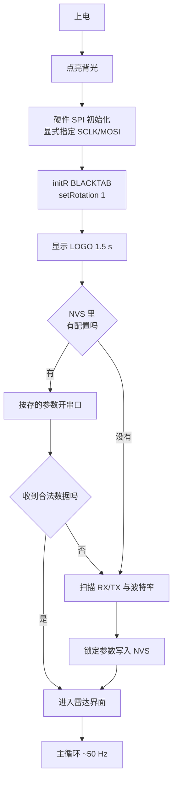

# 坎川工业 · 毫米波雷达跟踪器

ESP32-C3 + HLK-LD2450 24GHz 毫米波雷达 + ST7735 彩屏的实时目标跟踪与可视化固件。

屏幕上是半圆雷达图：扫描量程圈、目标光点、方位网格、底部防区状态条。
开机先显示一块 **坎川工业** LOGO（齿轮 + 坎卦 ☵），然后直接进入雷达界面。

```
       ╭──────────────╮          量程 6 m / ±95°
      ╱   ●              ╲       最多同时 3 个目标
     │       ●            │      声呐波纹式 ping 圆环向外扩散
     │  ────────────      │      底部 4 防区状态条
      ╲                    ╱
       ╰──────────────────╯
        ▓▓▓▓  ▓▓▓▓  ░░░░  ░░░░
```

**文档导航**：全部细节文档在 [`docs/`](docs/README.md)（显示实现 / 串口日志判读 /
常见问题 / 433 协议 / 涂鸦接入 / LOGO）。本文只讲怎么把设备跑起来。

---

## 硬件

| 部件 | 型号 | 备注 |
|---|---|---|
| 主控 | **ESP32-C3 SuperMini** | QFN32 rev v0.4，4 MB XMC flash，原生 USB-Serial/JTAG |
| 雷达 | **HLK-LD2450** | 24 GHz FMCW，UART 输出，出厂 256000 baud |
| 屏幕 | **ST7735** 1.8" 160×128 | SPI，横屏（rotation 1） |
| 无线 | **433 MHz OOK** 发射/接收模组 | 主机接收接 GPIO20，从机发射接 P5.5 |
| 振动 | 振动开关（可选） | 有源低触发 |

> **无线频段已统一为 433 MHz**（原 315 方案不再使用）。
> 本协议是纯脉宽编码，解码只依赖 DATA 脚时序，与载波频率无关 ——
> 换频段不需要改任何解码代码，只需要按波长剪天线：
> **λ/4 ≈ 17.3 cm**（裸铜丝，直出）。315M 模组若临时换上，天线改 23.8 cm 即可。
>
> 协议细节见 [docs/PROTOCOL-433M.md](docs/PROTOCOL-433M.md)。

### 接线

| ST7735 | ESP32-C3 | | HLK-LD2450 | ESP32-C3 |
|---|---|---|---|---|
| CS | GPIO1 | | TX | GPIO4 (RX) |
| DC | GPIO2 | | RX | GPIO5 (TX) |
| RST | GPIO3 | | VCC | **5V** |
| SCLK | **GPIO6** | | GND | GND |
| MOSI | **GPIO7** | | | |
| BLK | GPIO10 | | | |
| VCC | 3.3V | | | |
| GND | GND | | | |

**雷达要接 5V**，3.3V 供电会导致读数不稳甚至不出数。
振动开关接 GPIO8（可选）。

---

## 快速开始

### 1. 装依赖

```powershell
pip install -r requirements.txt          # 只需要 pyserial
pip install Pillow                        # 只有改 LOGO 才需要
```

### 2. 构建

```powershell
.\utils\build.ps1                 # 增量构建
.\utils\build.ps1 -Clean -Monitor # 干净重建 + 串口
```

### 3. 烧录

```powershell
.\utils\flash.ps1                 # 自动找串口 → 编译 → 烧录
.\utils\flash.ps1 -Monitor        # 烧完直接看串口
```

板子认不出来时：**按住 BOOT 再点一下 RESET**，让它进下载模式。

### 4. 改 LOGO

```powershell
python utils/fetch_seal_font.py                        # 想要篆书版先下字体
python utils/make_logo.py                              # 生成内置几何 LOGO
python utils/logo_converter.py utils\logo_160x128.png   # 转成固件点阵
.\utils\build.ps1
```

先看 `utils/logo_preview.png` 确认屏幕上的实际效果，再烧。

**换成自己的图**——把图片存成 `utils/logo.png`（也认 `.jpg/.jpeg/.bmp`）再跑
`logo_converter.py` 即可。自己放的图 `make_logo.py` 永远不会动。

设计理念与全部输出版本见 [docs/LOGO.md](docs/LOGO.md)。

### 5. 看日志

```powershell
python utils\serial_monitor.py    # 自动重连，已抑制 DTR/RTS 复位
```

**遇问题第一件事就是接串口。** 每条日志的判读方法见
[docs/SERIAL-LOG.md](docs/SERIAL-LOG.md)，速查表见
[docs/TROUBLESHOOTING.md](docs/TROUBLESHOOTING.md)。

---

## 工作原理

上电流程：



只识别一种数据帧头：`AA FF 03 00`，说明是雷达的目标跟踪帧。

雷达的**串口引脚和波特率只在第一次上电时扫描一次**，之后锁在 NVS 里，往后开机
直接按存的参数开串口，不再浪费时间扫描。想重新扫描：擦除 flash 重新上电。

主循环只做三件事：读帧 → 过滤 → 画。过滤条件是距离 0.05–8 m、角度 ±95°，
滤掉的是雷达偶发的 0 距离和越界噪声。

---

## 工程结构

```
HeartbeatSensor/
├── src/
│   ├── master/                     ★ 主机固件（ESP32-C3，PlatformIO）
│   │   ├── master.ino              主程序：初始化 + 主循环
│   │   ├── HLK_LD2450.h            雷达协议解析（header-only）
│   │   ├── RadarDisplay.h          雷达界面渲染（header-only）
│   │   ├── OokReceiver.h           433M OOK 接收 + 解帧
│   │   ├── ZoneManager.h           防区管理 / 配对 / NVS 持久化
│   │   ├── DebugLog.h              零堆分配日志 + 复位原因
│   │   ├── LogoImage.h             LOGO 点阵，脚本生成，勿手改
│   │   ├── TuyaLink.h              涂鸦云 MQTT + WiFi 状态机 + AP 配网
│   │   ├── TuyaConfig.h            涂鸦/配网参数集中配置
│   │   ├── QrTextImage.h           二维码说明文字点阵，脚本生成，勿手改
│   │   └── platformio.ini
│   └── slave/                      从机固件（STC8G1K08A，Keil C51）
├── docs/                           ★ 全部细节文档，入口 docs/README.md
│   ├── README.md                   文档索引
│   ├── DISPLAY.md                  屏幕渲染实现要点
│   ├── SERIAL-LOG.md               串口日志逐条判读
│   ├── TROUBLESHOOTING.md          常见问题速查
│   ├── PROTOCOL-433M.md            OOK 无线协议
│   ├── TUYA-DP-SETUP.md            涂鸦 DP 建点与配网
│   ├── LOGO.md                     LOGO 设计与生成
│   └── legacy-snapshots/           历史版本存档（不参与编译）
├── utils/                          构建 / 烧录 / LOGO / 串口脚本，见 utils/README.md
├── CHANGELOG.md
├── LICENSE                          MIT
└── requirements.txt
```

**在维护的固件只有两个**：主机 `src/master/`（PlatformIO）、从机 `src/slave/`（Keil C51）。
`docs/legacy-snapshots/` 里的都是历史版本，别拿去编译。

### 从机固件

需要 Keil C51 V9.60+：

```powershell
.\utils\build_slave.ps1          # 增量编译
.\utils\build_slave.ps1 -Clean   # 清理后完整重建
```

产出 `src\slave\Objects\slave.hex`，用 STC-ISP 烧录。

> ⚠️ `slave.uvproj` **不能带 UTF-8 BOM**，否则 UV4 静默失败（`Exit=15`，
> 不写日志、不报错、无产物）。`build_slave.ps1` 已自动检测并剥离。
> 同理，从机源码**必须保持 GBK 无 BOM**，转成 UTF-8 会让中文注释炸成语法错误。

### PlatformIO 工程

`platformio.ini` 里用 `src_dir = .` 把 sketch 目录本身当源码根：

```powershell
pio run -d .\src\master              # 构建
pio run -d .\src\master -t upload    # 烧录
```

**不要同时跑两个 `pio run`**，会互相破坏 `.pio\build`。

---

## 显示实现

屏幕子系统有一定陷阱（SPI 初始化顺序、离屏画布、脏矩形、推帧门控、配色分级、
角度约定），**完整说明见 [docs/DISPLAY.md](docs/DISPLAY.md)**。

三件必须知道的事：

- 必须在 `initR()` 之前调 `SPI.begin(TFT_SCLK, -1, TFT_MOSI, -1)`，任何地方都
  不要再调无参 `SPI.begin()`（会把 SCLK 从 GPIO6 挪到 GPIO4，直接花屏）
- 脏矩形起始列必须为偶数，否则 RISC-V 非对齐访存 panic
- SPI 时钟固定 20 MHz：40 MHz 会干扰 433 MHz 接收

---

## 按键

### 主机 BOOT

| 操作 | 效果 |
|---|---|
| 短按 BOOT | 开 / 关屏幕 |
| 双击 BOOT | 进入配对模式 |
| 长按 2 s | 开 / 关 WiFi（涂鸦云接入） |
| 长按 5 s | 恢复出厂（清防区 + 清 WiFi + 清三元组） |

配对模式内：单击切防区 A→B→C→D，长按 1.5 s 对当前防区开始配对。

### 从机 P3.2

| 操作 | 效果 |
|---|---|
| 单击 | 开启 / 关闭检测（切换） |
| 双击 | 进入配对模式（广播 20 s） |
| 长按 > 1.2 s | 无动作（防误触，整次丢弃） |

**从机上电默认待机**：不采样、继电器释放、只发 10 秒一次的「无人」心跳。
必须单击一次才真正开始检测。

> 为什么：RCWL-0515 和主板装在同一个壳里，上电后雷达会把**从机自己**
> 当成目标，OUT 直接拉高。原来「上电即检测」= 每台从机一上电就报有人，
> 主机所有防区同时亮红。改成上电待机后，装柜/调试期间从机是安静的，
> 装好、人离开、再按一下按钮才算真正布防。

**单击松手即刻生效**：开和关都是单击，都不等双击窗口。
0.4 s 窗口只在后台继续数第二下，唯一作用是判定「双击 = 配对」。

> 早先的写法把切换动作留到窗口结束才执行，于是关掉检测也要白等 0.4 s，
> 现场感受就是「按了没反应」。关闭检测是安全侧动作，多等 0.4 s 毫无意义。
> 代价：为了进配对而双击时，第一下会先切换一次检测状态；配对流程会
> 强制退出布防，不会留下错误的布防状态。

开启检测后还有 `APP_ARM_BLIND_MS`（500 ms）的雷达基线盲区，
这是留给人员撤离的时间，属于有意设计，不要改小。

待机期的 10 秒慢心跳让防区在屏上/APP 上保持**在线**（主机离线门限 45 s）。
若现场待机时防区偶尔闪一下离线（433 链路丢帧是成簇的），
把 `app.h` 里的 `APP_STANDBY_HB_MS` 改小到 `5000u`。

### 从机按键指示灯（P3.2，纯硬件）

SOP8 的 8 个脚已经全部占满（P5.4 继电器 / P5.5 433 发射 / P3.0 P3.1 ISP /
P3.2 按键 / P3.3 雷达），**没有第二个可用的 IO**。所以按键指示灯不占用
任何新引脚，直接**串在 P3.2 的按键回路上**：

```
VCC ── LED ── R(330Ω~1k) ── P3.2 ──[按键]── GND
```

原理：P3.2 是准双向口，平时锁存器 = 1、内部弱上拉导通，引脚被拉到 VCC，
LED 两端等电位 → 无电流 → 灯灭。按下按键把引脚拉到 GND，电流经 LED + R
灌入地 → 灯亮；同时单片机读到低电平，按键逻辑照常工作。

**效果：手指按住按钮灯就亮，松开就灭 —— 固件完全不参与，没有任何延时。**

| 电阻 | 电流 | 观感 |
|---|---|---|
| 330 Ω | ≈4 mA | 够亮，准双向口上拉承受得住 |
| 1 kΩ | ≈1.3 mA | 偏暗但省电，室内仍可见 |

> 低于 220 Ω 会超出准双向口的驱动能力：灯反而变暗，甚至引脚电平抬不到
> 能识别的高电平，按键会读不到。

P5.4 因此**保持纯继电器输出**，不再兼任指示灯，也不会再因为「提示闪烁」
把继电器带得咔哒响。

---

## 涂鸦云接入（可选功能）

默认关闭，离线优先。长按 BOOT 2 秒开 WiFi，再长按 2 秒关。

### 配网

1. 长按 BOOT 2 秒，设备开热点 `Kanchuan-HB-XXXX`（开放，无密码）
2. 手机连该热点，浏览器自动弹出配网页（或手动开 `192.168.4.1`）
3. 选路由、填密码，需要换设备时展开「涂鸦云三元组」填 DeviceID / DeviceSecret
4. 保存后设备自动重启并直连

三元组也可写死在 `TuyaConfig.h`（`TUYA_PRODUCT_ID` / `TUYA_DEVICE_ID` / `TUYA_DEVICE_SECRET`），NVS 优先于宏。

### DP 与绑定

11 个 DP（8 个 bool + 3 个数值），全部只上报。DP 清单、建点步骤、倍数填写、
三元组与数据中心设置见 **[docs/TUYA-DP-SETUP.md](docs/TUYA-DP-SETUP.md)**。

> ⚠️ 数值型 DP 的「倍数」必须填 **`0`**。填 `1` 会被平台当成一位小数，
> APP 上数字小 10 倍。

涂鸦智能 App **扫码添加不适用**——本固件直连云 MQTT，不走 App 配网，
不产生绑定 token。要进 App 需走云开发 OpenAPI 绑定或自研 App。

---

## 雷达规格

| 项目 | 参数 |
|---|---|
| 探测距离 | 0–6 m（本工程） |
| 角度范围 | ±60°（本工程过滤到 ±95°） |
| 最大目标 | 3 个 |
| 协议 | UART，头部 `AA FF 03 00` |
| 刷新率 | ~10 Hz（模组侧） |
| 屏幕量程标注 | 圈上标 `2m` / `4m` / `6m` |

### 航迹跟踪（为什么显示是稳的）

传感器本身只有 3 个目标槽位，而且会随时重排。直接照抄它的输出会看到三种
「不准」，本工程在画之前加了一层航迹跟踪来消除：

| 现象 | 原因 | 处理 |
|---|---|---|
| 同一个人莫名其妙换颜色 | 颜色按传感器槽位取，槽位会重排 | 持久航迹池 + 最近邻关联，目标自己占住一个槽 |
| 光点持续小幅抖动 | 传感器 10 Hz、屏幕 50 Hz，同一采样重复画 5 帧 | EMA 平滑（系数 0.45） |
| 目标偶尔闪一下消失 | 传感器漏采一次（该槽 x=y=0） | 350 ms 短时保持 |
| 角度偏一点 | 原按 2° 栅格对齐后查表 | 2° 查表 + 线性插值，量化误差 ~0.02° |

精确数值以云端 DP 为准（`radar_distance` 1 cm / `radar_angle` 1°），
屏幕上只标量程圈 `2m` / `4m` / `6m` 和方位角刻度 `-60 / -30 / 30 / 60`，
不占额外版面。

---

## 许可

MIT，见 [LICENSE](LICENSE)。

## 致谢

- **Adafruit** — GFX / ST7735 驱动
- **Hi-Link 海凌科** — HLK-LD2450 及协议文档
- **中央研究院 數位文化中心** — 崇羲篆體（小篆字体）
