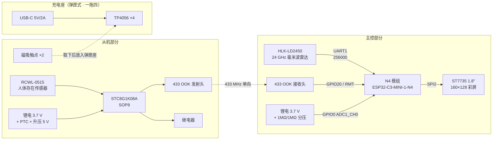

# 硬件说明 · 心跳传感器

本文件是硬件部分的**唯一权威说明**，用于配合[立创开源硬件平台（OSHW）](https://oshwhub.com/)
发布硬件设计文件。软件部分在
[GitHub 主仓库](https://github.com/kanchuan/HeartbeatSensor) 开源（MIT）。

> **发布状态**
> - 立创开源硬件平台项目地址：`（待发布后回填）`
> - 硬件版本：`v1.0`
> - 原理图 / PCB / 3D / BOM：`（待发布后回填）`
>
> 本仓库**不包含**任何 KiCad / 立创 EDA / Altium 工程文件，
> 硬件设计以 OSHW 平台上的版本为准，两者不一致时以 OSHW 版本为准。

---

## 1. 系统组成

整机由三部分组成：主机、从机、以及**弹匣式充电座**（一拖四）。
**主机与从机之间没有任何有线连接**，仅通过 433 MHz 单向 OOK 无线链路通信（从机 → 主机）；
从机自身不带充电电路，靠磁吸触点放回充电座充电。



> **从机自身不带充电电路**，只引出 2 片磁吸触点；充电由弹匣式充电座
> （一拖四）统一完成。详见 §6。

---

## 2. 物料清单（BOM）

| # | 部件 | 型号 / 规格 | 数量 | 备注 |
|---|---|---|---|---|
| 1 | 主控模组 | **ESP32-C3-MINI-1-N4**（N4 模组） | 1 | 4 MB flash，22 个 GPIO，原生 USB-Serial/JTAG |
| 2 | 毫米波雷达 | **HLK-LD2450** | 1 | 24 GHz FMCW，出厂 256000 baud |
| 3 | 显示屏 | **ST7735** 1.8" 160×128 | 1 | SPI，横屏（rotation 1） |
| 4 | 无线接收头 | 433 MHz OOK 接收模组 | 1 | 主机侧，DATA → GPIO20 |
| 5 | 无线发射头 | 433 MHz OOK 发射模组 | 1 | 从机侧，DATA → P5.5 |
| 6 | 从机 MCU | **STC8G1K08A**（SOP8） | 1 | 8 KB flash，Keil C51 |
| 7 | 人体存在传感器 | **RCWL-0515** | 1 | OUT → P3.3 |
| 8 | 继电器 | 5 V 微型继电器 | 1 | 低电平吸合，**必须并续流二极管** |
| 9 | 锂电（主机） | 3.7 V 锂电池 | 1 | 容量按续航需求选 |
| 10 | 分压电阻 | 1 MΩ × 2 | 2 | 1:2 分压，量程 0 ~ 3.1 V |
| 11 | 滤波电容 | **100 nF**（陶瓷） | 1 | ★ 分压中点，**不可省略** |
| 12 | 下拉电阻 | 10 kΩ | 1 | RCWL-0515 OUT 下拉，**不可省略** |
| 13 | 限流电阻 | 330 Ω ~ 1 kΩ | 1 | 从机按键指示 LED |
| 14 | 按键 | 轻触按键 | 2 | 主机 BOOT 键 + 从机配对键 |
| 15 | 振动马达 | 微型振动马达 | 1 | 可选，主人侧 GPIO21 驱动 |
| 16 | MOSFET | 低电平 N-MOS | 1 | 驱动振动马达 / 继电器 |
| 17 | LED | 3 mm / 5 mm | 1 | 从机按键指示 |
| 18 | 稳压 | 3.3 V LDO + 5 V 升压 | 1 | 雷达需 5 V，主控需 3.3 V |
| 19 | 锂电（从机） | 3.7 V 锂电池 502030 / 602030 | 4 | 200 ~ 600 mAh，见 §6.2 |
| 20 | 升压模块 | ME2108 / MT3608 → 5 V | 4 | 从机侧，见 §6.2 |
| 21 | PTC 自恢复保险 | 0.75 A | 4 | ★ 从机触点防短路，**不可省略** |
| 22 | 磁铁 | 钕铁硼 N35 Φ5×2 mm | 16 | 从机 8 + 充电座 8，见 §6.4 |
| 23 | 磁吸触点 | 镀金铜片 / Pogo pin | 8 | 从机侧 8 片（4 台 × 2） |
| 24 | 充电座 | **弹匣式一拖四**（含 TP4056 × 4、Pogo pin × 8、USB-C） | 1 | 见 §6.3 |
| 25 | 肖特基二极管 | SS14 | 4 | 充电座每路防反灌 |

---

## 3. 主机接线总表（N4 模组）

| 模块 | 模块引脚 | → N4 模组 | 方向 | 说明 |
|---|---|---|---|---|
| **ST7735** | CS | GPIO10 | 输出 | |
| | DC | GPIO1 | 输出 | |
| | RST | **EN**（模组复位脚） | — | 屏复位与 MCU 复位同步，不接任何 GPIO |
| | SCLK | **GPIO6** | 输出 | SPI2 IO_MUX 固定脚，不可换 |
| | MOSI | **GPIO7** | 输出 | SPI2 IO_MUX 固定脚，不可换 |
| | BLK | GPIO3 | 输出 | 背光 |
| | VCC | 3.3 V | 电源 | |
| | GND | GND | 地 | |
| **HLK-LD2450** | TX | GPIO4（UART1 RX） | 输入 | 雷达数据进主机 |
| | RX | GPIO5（UART1 TX） | 输出 | 主机配置雷达 |
| | VCC | **5 V** | 电源 | ★ 3.3 V 供电会读数不稳甚至不出数 |
| | GND | GND | 地 | |
| **433 OOK 接收头** | DATA | GPIO20 | 输入 | RMT 硬件解码 |
| | VCC | 按模组规格（3.3 V 或 5 V） | 电源 | 与模组配套 |
| | GND | GND | 地 | |
| **振动开关**（可选） | 一端 | GPIO21 | 输出 | 高电平有效，经 MOSFET 驱动马达 |
| | 另一端 | GND | 地 | |
| **BOOT 键** | 一端 | GPIO9 | 输入（内部上拉） | 按住上电进 ROM 下载模式 |
| | 另一端 | GND | 地 | |
| **电池分压** | 中点 | GPIO0 | 输入 | ADC1_CH0，见 §4 |

### 3.1 N4 模组引脚占用总表

```
TFT:   CS=10  DC=1  RST=EN  MOSI=7  SCLK=6  BLK=3
Radar: UART1  RX=4  TX=5          (UART0 = USB Serial，与调试共用)
433:   RX=20
振动:  GPIO21
BOOT:  GPIO9
电池:  GPIO0 (ADC1_CH0)
```

### 3.2 strapping 引脚与禁用脚

- **GPIO2 / GPIO8 —— 完全不用，悬空**：它们是 strapping 引脚，复位瞬间的电平
  参与决定启动模式，**不许挂任何输出器件**。
- **GPIO9 —— 只作 BOOT 按键输入（内部上拉）**：悬空 = 高 = 正常启动；
  按住上电进 ROM 下载模式。
- GPIO12~17 是片内 SPI Flash，**绝对不可外接**；
  GPIO18/19 是 USB D-/D+，被 `ARDUINO_USB_CDC_ON_BOOT=1` 占用。
- 掐掉 strapping（2/8/9）和 USB（18/19）后，可用 GPIO 只剩 **10 个**：
  0、1、3、4、5、6、7、10、20、21 —— **本工程已全部用完**，无空余引脚。

---

## 4. 电池电压检测电路

```
VBAT ──[1MΩ]──┬──[1MΩ]── GND
              ├──[100nF]── GND      ← 必须
              └── GPIO0 (ADC1_CH0)
```

| 项 | 值 | 说明 |
|---|---|---|
| 分压比 | 1 : 2 | 4.2 V 满电 → 中点 2.1 V |
| 衰减 | 12 dB (`ADC_11db`) | 量程约 0 ~ 3.1 V |
| 采样周期 | 10 s | 分压常驻耗电 2.1 µA，约 1.8 %/yr |

> ⚠️ **100 nF 那个电容不是可选的。** 两个 1MΩ 串联后的源阻抗高达 500 kΩ，
> 远超 SAR ADC 采样保持电路的理想值，会导致读数偏低。电容在中点充当
> 「电荷储备池」，把源阻抗降到接近 0。代码侧再配合「丢弃第 1 个读数 +
> 8 次平均」双保险。详见 `src/master/BatteryMonitor.h`。

---

## 5. 从机接线（STC8G1K08A SOP8）

| 脚 | 名称 | 接到 | 说明 |
|---|---|---|---|
| 1 | P5.4 | 继电器驱动（低电平吸合） | 必须并续流二极管，否则吸合地弹会冲击 P3.2 和 433 模组 |
| 2 | Vcc | **5 V**（电池经 PTC + 升压） | 见 §6.2 |
| 3 | P5.5 | 433 发射头 DATA | |
| 4 | Gnd | GND | 地 |
| 5 | P3.0 | STC-ISP 下载口 RXD | 保留，不接其它电路 |
| 6 | P3.1 | STC-ISP 下载口 TXD | 保留，不接其它电路 |
| 7 | P3.2 | 按键 → GND（LED 串在回路里） | 待机单击开检测 / 长按进配对 |
| 8 | P3.3 | RCWL-0515 OUT + **10 kΩ 下拉到 GND** | 下拉电阻必须装，否则传感器拔掉时读成“有人” |

按键指示灯串在 P3.2 回路上，纯硬件：

```
VCC ── LED ── R(330Ω~1k) ── P3.2 ──[按键]── GND
```

> SOP8 八个脚已全部占满，指示灯不额外占脚。按住按钮灯就亮，松开就灭 ——
> 固件完全不参与。

---

## 6. 从机供电与弹匣充电座

### 6.1 设计前提：从机自身不带充电电路

从机是**一次性装到现场**的独立节点（天花板、柜内、墙角），因此刻意**不做板载充电**：

- **SOP8 八个脚已全部占满**，没有引脚再接充电检测 / 充电状态灯。
- 现场没有 USB 可插，开 USB 孔反而增加进水与积灰风险。
- 从机侧任何充电电路都是长期的待机功耗与故障点。

所以从机的电池只引出**两片磁吸触点**，充电这件事**完全交给充电座**。

### 6.2 从机侧：电池、升压与磁吸触点

```
       ┌───────────── 从机外壳 ─────────────┐
       │  STC8G1K08A + RCWL-0515 + 433     │
       │            ▲                      │
       │            │ 5 V                  │
       │      [升压 ME2108]                 │
       │            ▲                      │
       │            │ 3.7 V                │
       │      [锂电 502030]                 │
       │            │                      │
       │      [PTC 0.75 A]   ← 必装         │
       │         ┌──┴──┐                   │
       └─────────┤ +   − ├─────────────────┘
              磁吸触点（2 片，镀金）
```

| 项 | 规格 | 说明 |
|---|---|---|
| 电池 | 单节锂电 3.7 V，502030 / 602030（200 ~ 600 mAh） | 容量按续航需求选 |
| 升压 | **ME2108 / MT3608** → 5 V | RCWL-0515 与 5 V 继电器需要 5 V |
| 磁吸触点 | 2 片，镀金铜片或 Pogo pin，**间距 ≥ 6 mm** | `+` / `−`，防呆见 §6.4 |
| **PTC 自恢复保险** | **0.75 A**，串在电池正极 | ★ 触点被金属物短接时的唯一保护 |
| 磁铁 | 钕铁硼 N35 Φ5×2 mm × 2 | 与座内磁铁吸合定位 |

> ⚠️ **PTC 不是可选的。** 两片触点直接连电池正负极，口袋里的一串钥匙、
> 桌上的一枚回形针都能瞬间短路锂电。PTC 在短路后几十毫秒内翻到高阻，
> 移开异物自动恢复，不需要更换。
>
> **若改用 3 V 继电器、且实测 RCWL-0515 在 3.3 V 下工作正常**，可以省掉升压、
> 由电池直供 —— 但必须**实测确认**，不能照抄。

### 6.3 充电座：弹匣形状，一拖四

充电座本身就是**弹匣**：4 个并排插槽，一次插 4 个从机，插进去即开始充电。

```
   俯视
   ┌──────────────────────────────────┐
   │   ┌────┐ ┌────┐ ┌────┐ ┌────┐    │  ← 4 个弹匣插槽
   │   │ ●● │ │ ●● │ │ ●● │ │ ●● │    │  ●● = 磁铁 + 触点
   │   └────┘ └────┘ └────┘ └────┘    │
   │                                  │
   │   [USB-C 5V/2A]         ○ 电源灯  │
   └──────────────────────────────────┘
```

| 项 | 规格 | 说明 |
|---|---|---|
| 输入 | USB-C **5 V / 2 A** | 4 路 × 500 mA |
| 充电 IC | **TP4056 × 4**（ESOP8） | 每路独立，互不影响 |
| 充电电流 | 每路 **500 mA**（`R_PROG = 2.4 kΩ`） | 200 mAh 电池降到 200 mA（`R_PROG = 6 kΩ`） |
| 状态灯 | 每路 红 = 充电中 / 蓝 = 充满 | TP4056 `CHRG` / `STDBY` 脚直驱 |
| 触点 | 每槽 2 个**弹簧顶针**（Pogo pin），镀金，行程 ≥ 1.5 mm | 与从机触点对位 |
| 磁铁 | 每槽 2 颗 N35 Φ5×2 mm | 吸力 ≥ 600 g / 槽 |
| 保护 | 每路串 **SS14 肖特基**，座内加总保险 | 防反灌、防座内短路 |

**充电时间**：500 mAh 电池 @ 500 mA ≈ **1.5 h**（含 CV 段）。
4 个同充总电流 2 A，USB-C 5 V/2 A 适配器刚好够。

### 6.4 磁极防呆（★ 必须做）

只有 2 个触点，插反就是**电池反接**。TP4056 自带反接保护不会炸，
但从机会被反充。所以用**磁极做机械防呆**，不靠电子防反：

- 每个插槽内磁铁极性固定：**左 S / 右 N**
- 从机外壳对应位置磁铁**反装**：左 N / 右 S
- 结果：**方向对了才吸得住，反了会被推开**

> 这比「加第 3 个触点做 ID 识别」便宜得多，也不会因为触点氧化而失效。

### 6.5 为什么不直接从机上加 USB-C

| 方案 | 从机成本 | 从机体积 | 现场风险 |
|---|---|---|---|
| 从机板载 USB-C + TP4056 | +2 元件 + 1 开孔 | +8 mm 高度 | 开孔进水、积灰、被异物捅 |
| **磁吸 2 触点 + 弹匣座（本方案）** | **0** | **0** | **无开孔** |

从机是一次性装到现场的，**充电动作发生在取下来之后**，
所以从机上不需要任何与「充电」相关的电路与结构。

---

## 7. 433 MHz 天线

无线频段统一为 **433 MHz**（原 315 MHz 方案不再使用）。
协议是纯脉宽编码，解码只依赖 DATA 脚时序，与载波频率无关，
换频段不需要改任何解码代码，只需按波长剪天线：

- **λ/4 ≈ 17.3 cm**（裸铜丝，直出）
- 若临时换上 315 MHz 模组，天线改 **23.8 cm** 即可

天线走线尽量远离 SPI 时钟线与雷达 UART 线，长度差异过大时需做阻抗匹配调试。

---

## 8. 装配与接线自检速查

| 现象 | 先查哪根线 |
|---|---|
| 花屏 / 斜纹 | SCLK 是否在 GPIO6、MOSI 是否在 GPIO7（不是 GPIO4） |
| **全白（背光亮）** | ① **CS/DC 是否互换**（两根线位置都变了，最易插反）② **RST 是否真焊到模组 EN**（悬空 → 屏停在未初始化态，恰好全白）③ **DC/CS 是否误接到 GPIO2**（strapping 脚，必须悬空）。全部无误仍白 → 把 `initR(INITR_BLACKTAB)` 换成 `INITR_GREENTAB` 或 `INITR_REDTAB` 重试 |
| 全黑 | 量背光 GPIO3 是否为高、屏 VCC 是否 3.3 V |
| 雷达不出数 | 雷达 VCC 是否接 **5 V**、TX/RX 是否接反 |
| 右上角电量不显示 | GPIO0 是否接上、中点 100 nF 是否焊了 |
| 防区一直离线 | 433 接收头 DATA 是否在 GPIO20、VCC 是否供上电 |
| 从机一直误报有人 | P3.3 的 10 kΩ 下拉是否焊上 |

---

## 9. 软件与硬件的对应关系

| 硬件行为 | 固件实现 | 文档 |
|---|---|---|
| 433 链路心跳包 | `src/master/OokReceiver.h` | [PROTOCOL-433M.md](PROTOCOL-433M.md) |
| 雷达帧解析 | `src/master/HLK_LD2450.h` | [DIAGNOSTICS.md](DIAGNOSTICS.md) |
| 屏幕渲染 | `src/master/RadarDisplay.h` | [DISPLAY.md](DISPLAY.md) |
| 电池采样 | `src/master/BatteryMonitor.h` | 本文 §4 |
| 从机固件 | `src/slave/source/` | [PROTOCOL-433M.md](PROTOCOL-433M.md) |

---

## 10. 开源协议

- **硬件设计**：按 OSHW 平台的开源硬件协议发布
  （CERN-OHL-P-2.0 / 以平台上所选协议为准）。
- **本仓库固件代码**：MIT License，见 [LICENSE](../LICENSE)。
- 第三方组件（Adafruit MIT/BSD、海凌科 HLK-LD2450、Keil C51 工具链）
  各自保留原有许可，见 [NOTICE](../NOTICE)。

---

## 11. 联系方式

Kanchuan Industrial <dev@kanchuan.local>
