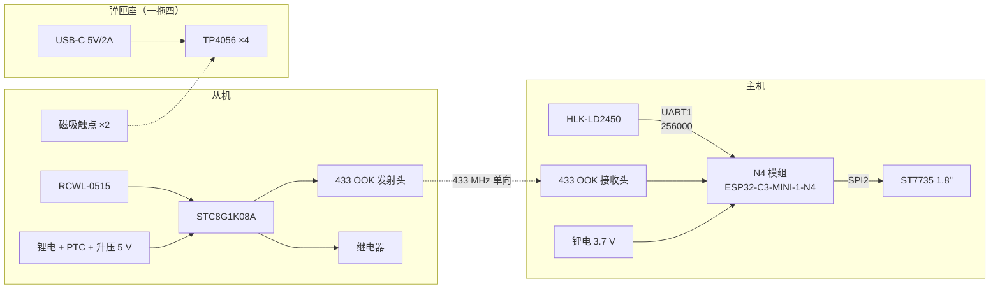

# 硬件说明 · 心跳探测器

**硬件设计（原理图 / PCB / 3D / BOM）在立创开源硬件平台发布，
本文件只记录固件强耦合的引脚约定与几条不可省略的硬件约束。**

> **立创开源硬件平台项目地址**：`（待发布后回填）`
> 硬件版本：`v1.0`
>
> 本仓库**不包含**任何 KiCad / 立创 EDA / Altium 工程文件。
> 硬件设计与本文件不一致时，**以立创平台上的版本为准**。

---

## 1. 系统组成

整机由三部分组成：**主机**、**从机**、**弹匣式充电座**（一拖四）。

- **主机**：N4 模组（ESP32-C3-MINI-1-N4）+ HLK-LD2450 24 GHz 雷达 + ST7735 彩屏
  + 433 接收头，锂电供电。
- **从机**：STC8G1K08A（SOP8）+ RCWL-0515 人体传感器 + 433 发射头 + 继电器，锂电供电。
- **充电座**：弹匣形状，4 槽，一次给 4 个从机充电。

**主机与从机之间没有任何有线连接**，只有 433 MHz 单向无线链路（从机 → 主机）。
从机自身不带充电电路，靠磁吸触点放回充电座充电。

---

## 2. 主机引脚约定（固件强耦合）

**改接线必须同步改代码** —— 以下映射硬编码在 `src/master/` 里。

| 功能 | N4 模组引脚 | 代码位置 |
|---|---|---|
| TFT CS / DC | GPIO10 / GPIO1 | `RadarDisplay.h` |
| TFT RST | **EN**（模组复位脚，不占 GPIO） | `RadarDisplay.h` |
| TFT SCLK / MOSI | **GPIO6 / GPIO7**（SPI2 IO_MUX 固定脚，不可换） | `RadarDisplay.h` |
| TFT 背光 BLK | GPIO3 | `RadarDisplay.h` |
| 雷达 UART1 | RX=GPIO4 / TX=GPIO5，**256000 baud** | `HLK_LD2450.h` |
| 433 接收 | GPIO20（RMT 硬件解码） | `OokReceiver.h` |
| 振动马达 | GPIO21 | `master.ino` |
| BOOT 键 | GPIO9（内部上拉） | `master.ino` |
| 电池采样 | GPIO0（ADC1_CH0） | `BatteryMonitor.h` |

### 2.1 不可用引脚

- **GPIO2 / GPIO8** —— strapping 脚，**必须悬空**，不许挂任何输出器件。
- **GPIO12 ~ GPIO17** —— 片内 SPI Flash，绝对不可外接。
- **GPIO18 / GPIO19** —— USB D-/D+，被 `ARDUINO_USB_CDC_ON_BOOT=1` 占用。

掐掉这些后可用 GPIO 只剩 **10 个**（0、1、3、4、5、6、7、10、20、21），
**本工程已全部用完，无空余引脚**。

---

## 3. 从机引脚约定（STC8G1K08A SOP8）

| 脚 | 名称 | 功能 |
|---|---|---|
| 1 | P5.4 | 继电器（低电平吸合） |
| 2 | Vcc | 5 V（电池经 PTC + 升压） |
| 3 | P5.5 | 433 发射头 DATA |
| 4 | Gnd | 地 |
| 5 | P3.0 | STC-ISP 下载口 RXD（保留，不接其它电路） |
| 6 | P3.1 | STC-ISP 下载口 TXD（保留，不接其它电路） |
| 7 | P3.2 | 按键 → GND（指示灯 LED 串在回路里） |
| 8 | P3.3 | RCWL-0515 OUT |

SOP8 八个脚已全部占满，**没有空脚**。

---

## 4. 不可省略的硬件约束

| 项 | 要求 | 为什么 |
|---|---|---|
| 雷达供电 | **必须 5 V** | 3.3 V 供电读数不稳甚至不出数 |
| 电池分压中点 | **并 100 nF** | 两个 1 MΩ 串联源阻抗达 500 kΩ，超出 SAR ADC 采样保持范围 → 读数偏低 |
| RCWL-0515 OUT | **10 kΩ 下拉到 GND** | 准双向口内部弱上拉会把悬空脚顶在阈值附近 → 传感器拔掉时误判「有人」 |
| 继电器 | **并续流二极管** | 否则吸合地弹会冲击 P3.2 与 433 模组 |
| 从机触点 | **串 PTC 0.75 A** | 两片触点直连电池正负极，金属异物短路时的唯一保护 |
| 天线 | **λ/4 ≈ 17.3 cm**（433 MHz，裸铜丝直出） | 临时换 315 MHz 模组时改 23.8 cm |

---

## 5. 从机供电与充电（只提及）

- **从机自身不带充电电路**：SOP8 八脚已占满、现场无 USB 可插、
  开孔反而增加进水与积灰风险、充电电路本身就是待机功耗与故障点。
- 从机只引出 **2 片磁吸触点**，电池正极串 **PTC 0.75 A** 后接触点。
- **充电座即弹匣本体**：4 槽一拖四，TP4056 ×4，USB-C 5 V / 2 A，
  每路 500 mA，500 mAh 电池约 1.5 h 充满。
- **磁极防呆**：座内左 S / 右 N，从机反装 → 方向对了才吸得住，反了被推开。

> 原理图、充电曲线、触点结构与装配公差 —— 见立创开源硬件平台上的项目。

---

## 6. 软件与硬件的对应关系

| 硬件行为 | 固件实现 | 文档 |
|---|---|---|
| 433 链路心跳包 | `src/master/OokReceiver.h` | [PROTOCOL-433M.md](PROTOCOL-433M.md) |
| 雷达帧解析 | `src/master/HLK_LD2450.h` | [DIAGNOSTICS.md](DIAGNOSTICS.md) |
| 屏幕渲染 | `src/master/RadarDisplay.h` | [DISPLAY.md](DISPLAY.md) |
| 电池采样 | `src/master/BatteryMonitor.h` | 本文 §4 |
| 从机固件 | `src/slave/source/` | [PROTOCOL-433M.md](PROTOCOL-433M.md) |

---

## 7. 开源协议

- **硬件设计**：按立创开源硬件平台所选协议发布（CERN-OHL-P-2.0 等）。
- **本仓库固件代码**：MIT License，见 [LICENSE](../LICENSE)。
- 第三方组件（Adafruit MIT/BSD、海凌科 HLK-LD2450、Keil C51 工具链）
  各自保留原有许可，见 [NOTICE](../NOTICE)。

---

## 8. 联系方式

Kanchuan Industrial <dev@kanchuan.local>
